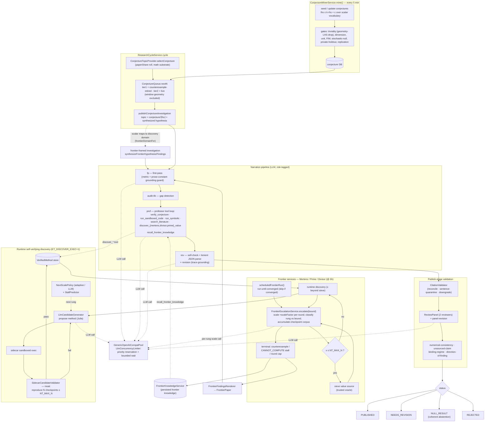

# Paper creation + discovery/frontier flow (room b72c4e10, math substrate)

Two paths produce papers: the **conjecture-investigation path** (left) and the **discovery /
frontier path** (right). They share the narration → validation → publish tail, and are bridged by
the `discover_*` professor tools and frontier-framing of conjecture investigations.

## Notes

- **Two discovery → paper triggers.** (1) Per-paper: the professor tool loop can call
  `discover_{mertens,divisor,prime}_value` (a moat-validated method computes the quantity past the
  sieve) and `recall_frontier_knowledge`. (2) Autonomous: the 6-hourly frontier services run the
  escalation loop and emit a `FrontierPaper`.
- **Frontier-framing bridge.** When a mined conjecture's scalar maps to a discovery domain
  (`frontierDomainFor`), `publishConjectureInvestigation` frames it as a frontier paper before
  narration — otherwise it stays in-range.
- **Gates.** Runtime discovery only executes when the sidecar is started with `ET_DISCOVER_EXEC=1`;
  otherwise frontier runs skip (zero tokens). Escalation stops on a counterexample, a
  `CANNOT_COMPUTE` stall, or the round cap.
- **Shared concurrency.** Every LLM call (narration, professor tools, candidate generation, per-rung
  scale decisions) acquires a permit from `GenericOpenAICompatPool` via the priority-aware,
  bounded-wait `LlmConcurrencyLimiter` (research roles reserved ahead of civic-simulation load).
